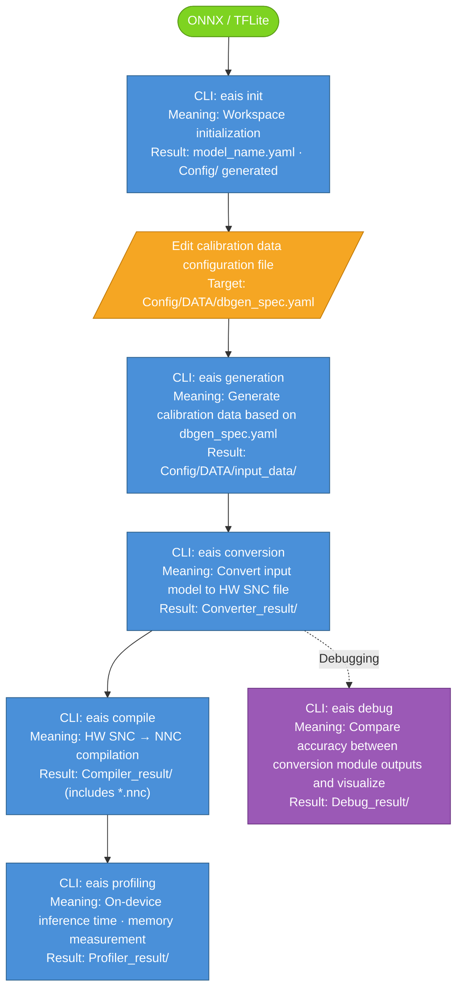
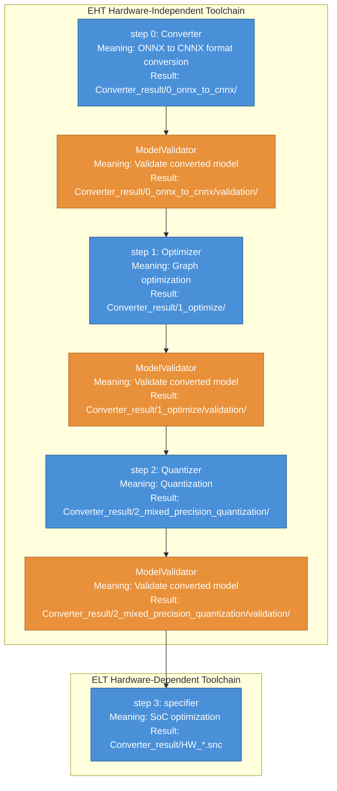

# Exynos AI Studio (EAIS) CLI User Guide

## Table of Contents

- [Terminology](#terminology)

1. [CLI Pipeline](#1-cli-pipeline)
2. [Workspace Structure](#2-workspace-structure)
3. [Step-by-Step CLI Usage](#3-step-by-step-cli-usage)
   - [Step 1: init](#step-1-init--workspace-initialization)
   - [Step 2: generation](#step-2-generation--calibration-data-generation)
   - [Step 3: conversion](#step-3-conversion--model-conversion)
     - [ModelValidator](#modelvalidator--converted-model-validity-check)
     - [\<model_name\>.yaml Parameter Guide](#model_nameyaml-parameter-guide)
   - [Option: debug](#option-debug--conversion-module-output-accuracy-comparison-and-model-visualization) → For details, see [eais_debug_guide.md](./eais_debug_guide.md)
   - [Step 4: compile](#step-4-compile--compile-snc-to-nnc)
   - [Step 5: profiling](#step-5-profiling--on-device-performance-measurement)
   - [nnc-reader](#nnc-reader--print-nnc-file-contents)
4. [Precautions and Troubleshooting](#4-precautions-and-troubleshooting)
5. [Quick Start & Practical Example: UDClassifier Model Conversion](#5-quick-start--practical-example-udclassifier-model-conversion)

---

## Terminology

### EAIS (Exynos AI Studio)

EAIS is a toolkit that converts, optimizes, and validates AI models to run on Exynos NPUs. It takes ONNX, TFLite, and other models as input and converts them into the `.nnc` format that can be executed on the NPU.

### Workspace

For an overview of the workspace concept and folder structure, refer to [EAIS_WhatsNew_SDK3.0.md → What is a workspace?](./EAIS_WhatsNew_SDK3.0.md#what-is-a-workspace). The detailed structure of files generated after running `eais init` is covered in [§2 Workspace Structure](#2-workspace-structure).

### SNC (Samsung Neural network Container)

SNC is an in-house **Intermediate Representation (IR)** format.
An IR is a format for describing neural networks; ONNX exported from PyTorch and TFLite exported from TensorFlow are both types of IR.
The EAIS pipeline accepts various external IRs such as ONNX and TFLite as input and converts them into its own IR, **SNC**, for consistent internal processing.

### CNNX

CNNX is the **IR used by the EHT toolchain**.
The pair of an ONNX model file (`.onnx`) and an encodings file (`.encodings`) containing quantization information is bundled together and called CNNX.

### EHT / ELT

Exynos AI Studio consists of two toolchains.

- **EHT (Exynos High-level Toolchain)**: An upper-level toolchain responsible for hardware-independent steps. It sequentially executes converter → optimizer → quantizer modules to perform IR conversion, graph optimization, and quantization, producing a quantized CNNX (`.onnx` + `.encodings`) as the output.
- **ELT (Exynos Low-level Toolchain)**: A lower-level toolchain responsible for hardware-dependent steps. The specifier module belonging to ELT takes the final output of EHT (quantized CNNX) as input and generates an **HW SNC** file optimized for the target SoC.

The `eais conversion` CLI executes the EHT → ELT toolchains sequentially.


---

## 1. CLI Pipeline

The diagram below shows the execution order of each CLI. The output paths generated by each CLI are relative to the workspace.



The minimum procedure is covered in [§5 Quick Start & Practical Example](#5-quick-start--practical-example-udclassifier-model-conversion).

---

## 2. Workspace Structure

This section describes how to prepare a workspace and the file structure generated after running `eais init`.

### Preparation
Place a model file with the same name as the folder name inside the workspace folder. When `eais init` is executed, a yaml file with the same name as the folder is generated.
```
<workspace>/           
└── <model_name>.onnx   # or .tflite
```

Example:
```
/home/user/eais-projects/
└── MyModel/
    └── MyModel.onnx
```


### Structure Generated After Running init

```
<workspace>/
├── <model_name>.onnx
├── <model_name>.yaml                     ← Main configuration file (core)
├── .input_conf.json                      ← Input model path information
├── package-info.txt                      ← EAIS version information
└── Config/
    ├── DATA/
    │   └── dbgen_spec.yaml               ← Calibration dataset specification (requires manual editing)
    ├── compiler_tuning_mode_config.yaml  ← compile tuning mode settings
    ├── conversion_expert.yaml            ← conversion advanced parameters
    ├── debug.yaml                        ← debug settings
    ├── layer_device_config.yaml          ← Per-layer execution device settings
    ├── post_processing_config.yaml       ← simulator post-processing settings
    ├── pre_processing_config.yaml        ← simulator pre-processing settings
    ├── profiler_advanced_config.yaml     ← profiling advanced settings
    └── remote_ssh_config.yaml            ← Remote SSH connection settings
```

---

## 3. Step-by-Step CLI Usage

Each CLI can specify the target workspace with the `--w <workspace_path>` option.

> [!TIP]
> **Omitting the `--w` option:** For all commands, the default value of `--w` is the current working directory (CWD).
> When running the CLI inside the workspace folder, `--w` can be omitted.
> ```bash
> cd /home/user/eais-projects/MyModel
> eais init        # Equivalent to eais init --w /home/user/eais-projects/MyModel
> eais generation
> eais conversion
> eais debug
> ```

### Step 1: init — Workspace Initialization

#### Command
```bash
eais init --w <workspace_path>
```

#### Example
```bash
eais init --w /home/user/eais-projects/MyModel
```

#### Behavior
- Generates `<model_name>.yaml`
- Creates the `Config/` directory and its configuration files
- Creates `Config/DATA/dbgen_spec.yaml` (default: random data)

> [!WARNING]
> - For workspace preparation rules (folder name = model file name), refer to [§2 Workspace Structure](#2-workspace-structure).
> - Re-running on an already initialized workspace will overwrite the existing yaml.

---

### Step 2: generation — Calibration Data Generation

#### Command
```bash
eais generation --w <workspace_path>
```

#### Example
```bash
eais generation --w /home/user/eais-projects/MyModel
```

#### Behavior
- Reads `Config/DATA/dbgen_spec.yaml` and generates npy data in a format usable for calibration.
- The generated npy files are used as calibration data during conversion.

#### Main Outputs
```
Config/DATA/
├── database.txt                           ← List of generated npy file paths
├── database.json                          ← Database metadata
└── input_data/
    ├── input_folder_mapping.json          ← Input name-to-folder mapping
    └── <input_name>/                      ← Folders by model input name
        ├── database_0000.npy              ← Per-sample npy files
        ├── database_0001.npy
        └── ...
```

- **`<input_name>/`**: Folders corresponding to each input tensor name of the model. The top-level keys of `dbgen_spec.yaml` (e.g., `data`, `feat_128`) become the folder names.
- **`input_folder_mapping.json`**: Contains mapping information between model input names and their corresponding npy folders. The conversion pipeline refers to this file to load the appropriate calibration data for each input.

#### How to Write dbgen_spec.yaml

`Config/DATA/dbgen_spec.yaml` **must be manually edited to match the actual number of model inputs**.
Since random data generation is set as the default when `eais init` is run, using it as-is may degrade conversion quality.

**Rules**
- Top-level keys (e.g., `data`, `feat_128`) should be written as the **model's input tensor name**. This name becomes the subfolder name of `input_data/` created when `eais generation` is run, and is used by the conversion pipeline to map each input.
- `shape` and `order` must always be defined regardless of the file extension (`ext`).

**Field Descriptions**

| Field | Description | Allowed Values |
|---|---|---|
| `random` | If `True`, generates random tensors without an actual dataset. For float dtype, uses uniform distribution `[0.0, 1.0)`; for int, uses uniform sampling across the full range of the type | `True` / `False` |
| `path` | Dataset folder. Relative paths (relative to the workspace) are recommended (see [path precautions](#path-precautions) below for details) | Relative path / absolute path |
| `ext` | File extension | `jpg`, `jpeg`, `png`, `bmp`, `raw`, `bin` |
| `shape` | Shape of the model input tensor. Must always be defined regardless of `ext` type | Example: `(1, 3, 384, 384)` |
| `order` | Dimension order of the input data. `nchw`: (batch, channel, height, width) — PyTorch default. `nhwc`: (batch, height, width, channel) — TensorFlow/OpenCV default | `nchw`, `nhwc`, `chw`, `hwc` |
| `dtype` | Data type | `float32`, `float16`, `float64`, `uint8`, `int8`, `uint16`, `int16`, `int32`, `int64`, `bool` |
| `mean` | Preprocessing mean value. `output = (raw - mean) * scale`. Scalar or list of length equal to number of channels. Default `0` (no mean subtraction) | Example: `[0]`, `[0.485, 0.456, 0.406]` |
| `scale` | Preprocessing scale. If `scale > 1`, it is internally inverted to `1/scale`. Example: `scale: 255` → divides pixel values by 255 to normalize to `[0, 1]`. Default `1` | Example: `[1]`, `[255]` |

> [!NOTE]
> If your prepared dataset does not require additional preprocessing, keep the defaults `mean: [0]`, `scale: [1]`. Then `output = (raw - 0) * 1 = raw`, so the raw files are used as-is for calibration data.

##### Using an Actual Dataset (Recommended)
```yaml
data:
  random: False
  path: ./dataset
  ext: raw
  shape: (1, 3, 384, 384)
  order: nchw
  dtype: float32
  mean: [0]
  scale: [1]
```

##### For Multiple Inputs
When the model has multiple inputs, specify information for each model input name.
```yaml
data:
  random: False
  path: ./dataset/data
  shape: (1, 3, 512, 512)
  dtype: float32
  order: nchw
  ext: raw
feat_128:
  random: False
  path: ./dataset/feat_128
  shape: (1, 56, 128, 128)
  dtype: float32
  order: nchw
  ext: raw
feat_64:
  random: False
  path: ./dataset/feat_64
  shape: (1, 112, 64, 64)
  dtype: float32
  order: nchw
  ext: raw
```

##### Using Random Data (For Quick Testing)
```yaml
data:
  random: True
  shape: (1, 3, 384, 384)
  order: nchw
  dtype: float32
  mean: [0]
  scale: [1]
```

> [!NOTE]
> Even when `random: True`, `shape`, `order`, and `dtype` must be specified to match the actual model input. EAIS uses these values to generate random tensors.

#### path Precautions

> [!NOTE]
> **path precautions:** Relative paths are interpreted relative to the workspace folder (the folder where `Config/DATA/dbgen_spec.yaml` is located).
> For example, if the workspace is `~/MyModel/` and the dataset is at `~/MyModel/dataset/`, specify `path: ./dataset`.
> To reference a dataset outside the workspace, use an absolute path (e.g., `/data/calibration/MyModel/`).

| Input Example | Interpretation | Recommended |
|---|---|---|
| `path: ./dataset` | `<workspace>/dataset` | **Recommended** (when running inside the workspace) |
| `path: /home/user/eais-projects/MyModel/dataset` | Absolute path | OK |

---

### Step 3: conversion — Model Conversion

#### Module Description

`eais conversion` runs the following modules in order.

| Module | Toolchain | Role |
|---|---|---|
| **Converter** | EHT | Converts external IR (ONNX / TFLite) into CNNX (ONNX + Encodings), the EHT IR format. |
| **Optimizer** | EHT | Analyzes the CNNX graph and performs hardware-independent graph optimizations such as removing or merging unnecessary operations. |
| **Quantizer** | EHT | Applies mixed-precision quantization using calibration data. |
| **ModelValidator** | EHT | Automatically invoked right after Converter, Optimizer, and Quantizer to validate the converted model. |
| **Specifier** | ELT | Takes the quantized CNNX as input and generates an HW SNC optimized for the target SoC. |

#### Internal Pipeline

`eais conversion` executes 4 module steps in EHT → ELT order.



#### Command
```bash
eais conversion [--w WORKSPACE_PATH] [--f YAML_PATH]
                [--eht | --elt]
                [--<key> <value> ...]
```

#### Options

| Option | Default | Description |
|---|---|---|
| `--w WORKSPACE_PATH` | Current working directory | Workspace path. Must be a folder with the same name as the model file, and must be initialized via `eais init`. |
| `--f FILE` | `<workspace>/<model_name>.yaml` | Path to the YAML configuration file defining conversion parameters. Default is `<model_name>.yaml` generated by `eais init`. Use this to specify an alternative configuration file. |
| `--eht` | Not set | Runs only the EHT stage: converter → ModelValidator → optimizer → ModelValidator → quantizer → ModelValidator. Performs hardware-independent conversion and generates quantized CNNX (ONNX + encodings). Use only when intentionally skipping the hardware-dependent stage. **In most cases, omitting both `--eht` and `--elt` is recommended.** |
| `--elt` | Not set | Runs only the specifier stage. Generates a device-specific SNC based on already-completed EHT results (quantized CNNX). Use only when a valid EHT result exists in the workspace. **In most cases, omitting both `--eht` and `--elt` is recommended.** |
| `--<key> <value>` | None | Additional option that overrides parameters in the YAML configuration file. Has the highest priority. Example: `--precision A8W8 --device Gen-8` |

#### Examples

```bash
# Default run (full EHT + ELT pipeline, recommended for most cases)
eais conversion --w /home/user/eais-projects/MyModel

# Specify an alternative YAML configuration file
eais conversion --w /home/user/eais-projects/MyModel \
  --f /home/user/eais-projects/MyModel/MyModel_A16W8.yaml

# Override parameters from the CLI (without modifying the YAML)
eais conversion --w /home/user/eais-projects/MyModel \
  --precision A16W8 --calibration_method percentile

# Run only the EHT stage (hardware-independent conversion, generate quantized CNNX)
eais conversion --w /home/user/eais-projects/MyModel --eht

# Run only the ELT stage (reuse EHT result, re-convert to a different target SoC)
eais conversion --w /home/user/eais-projects/MyModel --elt --device Gen-8

# Override only the device parameter from CLI (change target without modifying YAML)
eais conversion --w /home/user/eais-projects/MyModel --device Gen-9
```

#### Main Outputs
```
<workspace>/
├── Converter_result/
│   ├── 0_onnx_to_cnnx/output.onnx
│   ├── 1_optimize/output.onnx
│   ├── 2_mixed_precision_quantization/output.onnx
│   ├── HW_<model_name>_<version>.snc     ← Final converted model for NPU execution
│   └── NPU_<model_name>/testvector/       ← Test vector for compile
└── Debug_result/
    └── pipeline_artifacts.json           ← Required for the eais debug command
```


> [!WARNING]
> - Before conversion, npy calibration data must be generated first via `eais generation`.
> - If the folder pointed to by `calibration_data_path` has no npy files, EAIS checks for h5 files, and if neither exists, calibration fails.
> - After conversion completes, `Debug_result/pipeline_artifacts.json` is automatically generated. This file is required when running `eais debug --mode accuracy` / `--mode all`.

### ModelValidator — Converted Model Validity Check

Performed a total of three times: immediately after Converter, Optimizer, and Quantizer complete. The inspection results are stored under `validation/` within each stage's result directory.

```
Converter_result/
├── 0_onnx_to_cnnx/
│   └── validation/
│       └── model_validation_results/
│           ├── output.onnx              ← Model under inspection (revised version; identical to the original if no changes)
│           ├── output.encodings         ← Encodings under inspection (only exists at CNNX stage)
│           ├── report.html              ← HTML report of inspection results
│           └── validation_report.json   ← JSON of inspection results (per-validator PASSED/FAILED and details)
├── 1_optimize/
│   └── validation/
│       └── model_validation_results/
│           └── ...
└── 2_mixed_precision_quantization/
    └── validation/
        └── model_validation_results/
            └── ...
```

#### validation_report.json Structure

`validation_report.json` contains per-item inspection results.

- **`metadata.ir_type`**: IR type under inspection (`onnx` / `cnnx`)
- **`results`**: Per-validator results. If all pass, this is an empty object `{}`
  - **`status`**: `PASSED` / `FAILED`
  - **`fail_list`**: List of failed items. Each item contains the node name, error code, message, and cause.

**When all pass** (`0_onnx_to_cnnx` stage, `ir_type: onnx`):

```json
{
  "metadata": {
    "ir_type": "onnx"
  },
  "results": {}
}
```

In `report.html`, the status of each validator can be checked via a Summary table and detail panels.


**When there are FAILED items** (`2_mixed_precision_quantization` stage, `ir_type: cnnx`):

```json
{
  "metadata": {
    "ir_type": "cnnx"
  },
  "results": {
    "weight_granularity": {
      "validator_name": "weight_granularity",
      "status": "FAILED",
      "fail_list": [
        {
          "name": "/stage2/0/1/2_1/Resize/dwdeconv/weight_2",
          "code": "InvalidWeightSymmetry",
          "message": "Weight symmetry configuration is invalid",
          "component": "KERNEL",
          "info": {
            "node_name": "/stage2/0/1/2_1/Resize/DWDeconv_5",
            "op_type": "ConvTranspose",
            "enc_type": "PER_TENSOR",
            "is_sym": true,
            "expected_sym": false,
            "reason": "PER_TENSOR must be asymmetric"
          }
        }
      ],
      "info": null,
      "corrections": []
    }
  }
}
```

You can see FAILED items at a glance in the Summary table of `report.html`, and inspect the cause per failed node in the detail panel.


After Converter and Optimizer, the ONNX model inspection items (4 items) are performed.

| Validator | Inspection Content |
|---|---|
| `DynamicInputValidator` | Checks whether the graph input has non-integer dynamic dimensions such as `"batch"` or `"seq_len"` |
| `RuntimeCompatibilityValidator` | Verifies whether the model runs normally by feeding dummy input via ONNX Runtime |
| `OpsetVersionValidator` | Checks ONNX opset version: {13–21} pass, {1–12} can be auto-converted to 13, others fail |
| `ContainsEinsumValidator` | Checks whether the `Einsum` operator, which is not supported by the downstream toolchain, is present |

After Quantizer, in addition to the above items, quantization encodings-related items (CNNX inspection) are performed.

| Validator | Inspection Content |
|---|---|
| `AttributeConstraintValidator` | Node attribute value hardware constraint check (detects disallowed values such as negative `axis`) |
| `ConstantConstraintValidator` | Checks whether constant/initializer tensors contain `+/-Inf` values |
| `UnexpectedActivationQParamValidator` | Checks whether qparam is attached to the outputs of operators such as Shape, Gather, Cast where qparam is unnecessary |
| `UnexpectedParamQParamValidator` | Checks whether qparam is attached where it should not be, such as bias or parameters of quantization-prohibited operators |
| `QParamIsSymFormatValidator` | Checks whether the `is_sym` field is in the AIMET standard format (`"True"`/`"False"`) |
| `QParamOffsetRangeValidator` | Checks whether the qparam offset is within a valid range depending on symmetric/asymmetric |
| `QParamBitwidthValidator` | Checks whether activation bitwidth ∈ {8, 16} and weight bitwidth ∈ {4, 8} |
| `QParamFormatValidator` | Checks whether `quantizer_args` exists and is in the correct format without null values |
| `TrivialQParamValidator` | Detects identity qparam with `scale=1.0`, `offset=-(2^bw-1)` where there is effectively no quantization |
| `MissingActivationQParamValidator` | Checks whether qparam is missing on float activation·graph input |
| `MissingParamQParamValidator` | Checks whether qparam is missing on the weight of Conv, Gemm, MatMul, etc. |
| `PassthroughQParamValidator` | Checks whether the input/output qparam of passthrough operators such as Reshape, Transpose, Slice are identical |
| `OutputQParamConsistencyValidator` | Checks whether all output qparams of operators such as Split, which require identical output qparam, match |
| `ConcatQParamConsistencyValidator` | Checks whether the input/output qparams of Concat nodes match |
| `ConstantActivationQParamValidator` | Checks whether the encoding of constant inputs of Add, Mul is recorded in `activation_encodings` rather than `param_encodings` |
| `WeightGranularityValidator` | Weight qparam granularity check: PER_TENSOR must be asymmetric, PER_CHANNEL must be symmetric, and the number of scales must match the channel axis size |
| `ActivationDtypeValidator` | Checks whether the dtype of all activation tensors is `float` or `float16` |
| `AimetCompatibilityValidator` | Loads into AIMET `QuantizationSimModel` and checks whether the encoding name exists in `qc_quantize_op_dict` |

### \<model_name\>.yaml Parameter Guide

After running `eais init`, `<workspace>/<model_name>.yaml` is generated.
This file is the default parameter source for all CLIs.

#### general Section

The default configuration file generated by `eais init`, referenced throughout the entire EAIS pipeline.

| Key | Default | Description |
|---|---|---|
| `device` | `Gen-9` | Target SoC on which the model will run. Configure to match the deployment target hardware. |

| Value | Description |
|---|---|
| `Gen-9` | Ulysses (S5E9975) |
| `Gen-8` | Thetis (S5E9965) |
| `Gen-7` | Solomon (S5E9955), Terra (S5E8865), Vesper (S5E8875) |
| `Gen-6` | Root (S5E9945) |
| `Gen-5` | Quadra (S5E9945), Santa (S5E8855), Rose (S5E8845), Kitt2 (S5AV920) |
| `Gen-4` | Pamir (S5E9925) |
| `Gen-3` | Olympus (S5E9840), Quartz (S5E8835) |
| `Gen-2` | 2020AP (S5E9830) |

> [!WARNING]
> If the `device` setting differs from the actual target hardware, compile/profiling results are invalid.

#### database_gen Section

| Key | Default | Description |
|---|---|---|
| `database_spec` | `Config/DATA/dbgen_spec.yaml` | Path to the spec file referenced during `eais generation`. Relative path from the workspace root. |

#### converter Section

| Key | Default | Description |
|---|---|---|
| `use_cuda` | `false` | Whether to use CUDA (GPU) for ONNX/CNNX conversion and quantization. GPU acceleration significantly improves calibration speed. |
| `precision` | `A8W8` | Quantization precision profile. For already-quantized models, use `skip_quantization: true`. |
| `skip_quantization` | `false` | Skip the quantization stage. When set to `true`, treats the input as already quantized and proceeds directly to specifier. |
| `calibration_mode` | `default` | Calibration mode. |
| `calibration_method` | `minmax` | PTQ quantization range (scale/offset) estimation algorithm. |
| `calibration_data_path` | `Config/DATA` | Path to the calibration dataset folder. Contains per-input subfolders and `dbgen_spec.yaml`. |
| `input_dtype` | `float32` | Forces the input tensor dtype of the quantized model. Defaults to float32; set when a different dtype is required. |
| `output_dtype` | `float32` | Same as `input_dtype`. |
| `advanced_quantization_algorithm` | `null` | Optional weight tuning algorithm applied on top of standard quantization. |
| `graph_opt` | `common` | Graph optimization profile tailored to specific model families. |
| `expert_yaml` | `Config/conversion_expert.yaml` | Path to the advanced conversion configuration file that extends/overrides values in this file. |

##### `use_cuda`

| Value | Description |
|---|---|
| `true` | Run calibration on GPU (fast, requires a CUDA-capable device) |
| `false` | Run calibration on CPU |

##### `precision`

| Value | Description |
|---|---|
| `FP16` | 16-bit floating point, no integer quantization |
| `A16W8` | 16-bit activation, 8-bit weight |
| `A16W4` | 16-bit activation, 4-bit weight |
| `A8W8` | 8-bit activation, 8-bit weight (the most common integer profile) |
| `A8W4` | 8-bit activation, 4-bit weight |
| `MXINT8` | Microscaling INT8 |

##### `calibration_mode`

| Value | Description |
|---|---|
| `default` | Apply the method specified in `calibration_method` to the entire calibration data |
| `auto` | Automatically search for the optimal calibration method by weight/activation type |

##### `calibration_method`

| Value | Description |
|---|---|
| `minmax` | Compute scale directly from tensor min/max. Fastest |
| `percentile` | Percentile-based outlier clipping. Useful for heavy-tailed distributions |
| `histogram_enhanced` | AIMET tf-enhanced, histogram-based KL divergence minimization. Most accurate but slow |

##### `input_dtype` / `output_dtype`

| Value | Description |
|---|---|
| `float32` | 32-bit float (default) |
| `float16` | 16-bit float |
| `uint8` | unsigned 8-bit |
| `int8` | signed 8-bit |
| `uint16` | unsigned 16-bit |
| `int16` | signed 16-bit |
| `none` | Preserve the original model dtype |

##### `advanced_quantization_algorithm`

| Value | Description |
|---|---|
| `smoothquant` | Reduces quantization error via joint activation-weight scaling |
| `adaround` | Training-based per-weight rounding decision for low-bit quantization |
| `null` | No advanced algorithm applied |

##### `graph_opt`

| Value | Description |
|---|---|
| `gaussi_xs_unet` | GaussI XS U-Net |
| `gaussi_xs_te` | GaussI XS text encoder |
| `gaussi_xs_ie` | GaussI XS image encoder |
| `gaussi_xs_vae_decoder` | GaussI XS VAE decoder |
| `gaussi_xs_ip` | GaussI XS image prompt |
| `s26_gausslprefill` | S26 GaussL prefill |
| `animated_diff` | AnimatedDiff |
| `semantic_search` | Semantic search model |
| `common` | General-purpose optimization |
| `none` | No graph optimization |

#### compiler Section

| Key | Default | Description |
|---|---|---|
| `mode` | `default` | Compiler preset. Selects a built-in parameter bundle. |
| `debug_str` | `null` | Optional debug flag string passed to the compiler. Set only when reproducing a specific build. |
| `compiler_advanced_config` | `Config/compiler_tuning_mode_config.yaml` | Path to the advanced compiler configuration file used when `mode=tuning_mode`. |

##### `mode`

| Value | Description |
|---|---|
| `default` | Standard single-core build |
| `multicore` | Enables multicore layout/scheduling |
| `tuning_mode` | Uses parameters from `compiler_advanced_config` file (for advanced users) |
| `gen-ai` | Generative AI optimization preset |
| `gaussl` | GaussL preset |
| `gaussi` | GaussI preset |

#### profiler Section

| Key | Default | Description |
|---|---|---|
| `device_id` | `NOT_USE` | Numeric ID of the target device connected to the server/PC on which EAIS docker is running. |
| `ssh_bool` | `SSH_FALSE` | How the Profiler accesses the device. |
| `profiler_advance_config` | `Config/profiler_advanced_config.yaml` | Path to the advanced profiler configuration file. |

##### `device_id`

| Value | Description |
|---|---|
| `<number>` | Device ID identified from `adb devices` or the device manager |
| `NOT_USE` | Run without a connected device (skip device selection) |

##### `ssh_bool`

| Value | Description |
|---|---|
| `SSH_TRUE` | Connect to the remote device via SSH |
| `SSH_FALSE` | Use a directly connected device (USB / local) |

---

### Option: debug — conversion Module Output Accuracy Comparison and Model Visualization

For commands, options and parameters, and detailed usage, refer to [eais_debug_guide.md](./eais_debug_guide.md).

---

### Step 4: compile — Compile SNC to NNC
```bash
eais compile --w <workspace_path>
```
- Compiles `Converter_result/HW_*.snc` into an NPU-executable `.nnc` file.
- Output: `Compiler_result/<model_name>.nnc`

| `compiler.mode` Value | Description |
|---|---|
| `default` | Default settings |
| `multicore` | Utilize NPU multicore |
| `tuning_mode` | Detailed tuning via `compiler_tuning_mode_config.yaml` |
| `gen-ai` | Optimization for Generative AI models |

### Step 5: profiling — On-Device Performance Measurement
```bash
eais profiling --w <workspace_path>
```
- Measures inference time, memory usage, etc. of the `.nnc` model on an actual Exynos device.
- Output: `Profiler_result/`
- Requires device connection. `profiler.device_id`, `profiler.ssh_bool`, etc. must be configured in advance.

### nnc-reader — Print NNC File Contents
```bash
eais nnc-reader <path/to/model.nnc>
```
- Prints the layer structure and metadata of the compiled `.nnc` file to the terminal.

---

## 4. Precautions and Troubleshooting


### Common Errors

#### 1. `EAIS error: files with model name '<name>' does not exist in workspace.`

Occurs when the workspace **folder name** and the `.onnx` / `.tflite` **file name** do not match.

**Example Error Message**
```
Error code: 102
Error msg: workspace error
Details:
files with model name 'mismatch' does not exist in workspace.
```

**Cause:** EAIS locates the model file based on the workspace folder name. If the folder name is `mismatch` but the folder contains only `differentname.onnx`, EAIS fails to find `mismatch.onnx`.

```
mismatch/
└── differentname.onnx     # ❌ Differs from folder name
```

**Solution:** Match the model file name or the folder name.
```
01-5_model/
└── 01-5_model.onnx        # ✅ Folder name = file name
```

#### 2. `ValueError: cannot reshape array of size <N> into shape (...)`

Occurs when `eais generation` is run and the `shape`, `dtype`, or `order` specified in `dbgen_spec.yaml` does not match the actual raw file size, so numpy cannot reshape into that form.

**Example Error Message**
```
ValueError: cannot reshape array of size 786432 into shape (1,1,3,999,999)
...
RuntimeError: Pipeline failed: Pipeline failed at step 0: step_0_dbgen_database_gen
```

**Cause:** The actual byte count of the `.raw` file must equal `dtype size × number of shape elements`.
Example: `shape: (1, 3, 384, 384)`, `dtype: float32` → file size is `4 × 1 × 3 × 384 × 384 = 1,769,472 bytes`

**Solution:** Modify `shape` and `dtype` to match the actual raw file size. For image processing models, they should mostly match the shape/dtype of the model input tensor.

#### 3. `IndexError: list index out of range` (When Running `--elt` Alone)

Occurs when `--elt` is run alone without EHT results. `--elt` is an option that reuses an already-completed EHT result (quantized CNNX).

**Example Error Message**
```
File ".../eais/models/converter.py", line 68, in refactor_input_model
    if os.path.exists(os.path.join(output_dir, sorted_eht_result[-1], ...)):
IndexError: list index out of range
```

**Cause:** The workspace's `Converter_result/` does not contain valid EHT results (`0_onnx_to_cnnx/`, `1_optimize/`, `2_mixed_precision_quantization/`).

**Solution:**
- For first-time conversion: Run the full pipeline with `eais conversion --w <workspace>` without options.
- Only when re-converting to a different SoC: First complete the EHT stage with `--eht`, then run `--elt`.
  ```bash
  eais conversion --w <workspace> --eht
  eais conversion --w <workspace> --elt --device <different_SoC>
  ```

#### 4. `Compile failed: Pipeline failed at step 0: step_0_graphgen_model_compile`

Occurs when `eais compile` cannot find the `Converter_result/HW_*.snc` file it requires. This is mostly the case when `eais conversion` was not run or failed midway.

**Solution:** After successfully completing `eais conversion`, run `eais compile`.
```bash
eais conversion --w <workspace_path>
eais compile --w <workspace_path>
```

---

## 5. Quick Start & Practical Example: UDClassifier Model Conversion

This section describes the minimum procedure to convert an ONNX model into an NPU-executable `.nnc`, based on the `01-1_Preview_UDClassifier` workspace. For detailed options at each stage, refer to [§3 Step-by-Step CLI Usage](#3-step-by-step-cli-usage).

### Environment
- Model: `01-1_Preview_UDClassifier.onnx`
- Input shape: `(1, 3, 384, 384)`, dtype: `float32`
- Dataset: `.raw` files inside the `dataset/` folder (float32, 384×384×3)
- Container: `example_container` (assumes the host's workspace folder is mounted into the container)

### Step 0: Enter the Docker Container
```bash
docker exec -it example_container /bin/bash
```

### Step 1: Initialize the Workspace — Generate `<model_name>.yaml` and `Config/`
```bash
eais init --w /home/user/eais-projects/01-1_Preview_UDClassifier
```

### Step 2: Write `dbgen_spec.yaml`
```bash
# Edit the file directly inside the container
vi /home/user/eais-projects/01-1_Preview_UDClassifier/Config/DATA/dbgen_spec.yaml
```

```yaml
data:
  random: False
  path: /home/user/eais-projects/01-1_Preview_UDClassifier/dataset
  ext: raw
  shape: (1, 3, 384, 384)
  order: nchw
  dtype: float32
  mean: [0]
  scale: [1]
```

### Step 3: Generate `.npy` Data for Calibration
```bash
eais generation --w /home/user/eais-projects/01-1_Preview_UDClassifier
```

### Step 4: Model Conversion (Full EHT + ELT Pipeline)
```bash
eais conversion --w /home/user/eais-projects/01-1_Preview_UDClassifier
```

### Step 5: (Optional) Per-Stage Accuracy Validation
```bash
eais debug --w /home/user/eais-projects/01-1_Preview_UDClassifier
```

### Step 6: (Optional) SNC → NNC Compilation
```bash
eais compile --w /home/user/eais-projects/01-1_Preview_UDClassifier
```

### Verifying Outputs
```
01-1_Preview_UDClassifier/
├── Converter_result/
│   └── HW_updated_model_new_snc_<version>.snc   ← Step 4 output (converted model for NPU execution)
├── Debug_result/
│   └── accuracy_validation_results/
│       └── accuracy_comparison.xlsx              ← Step 5 output (per-stage SNR/PSNR report)
└── Compiler_result/
    └── 01-1_Preview_UDClassifier.nnc             ← Step 6 output (NPU execution file)
```
