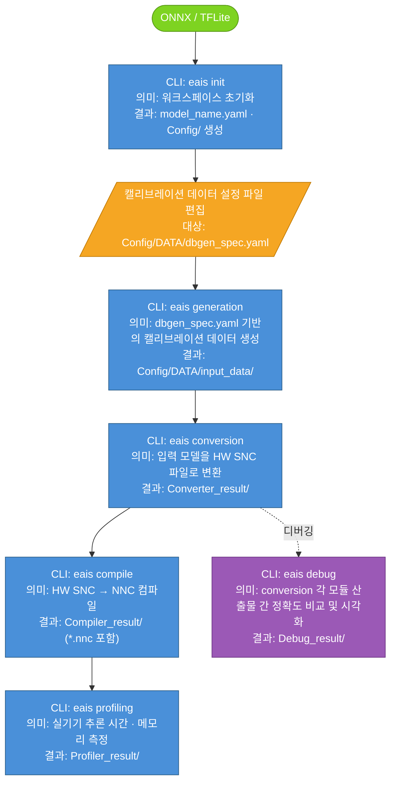
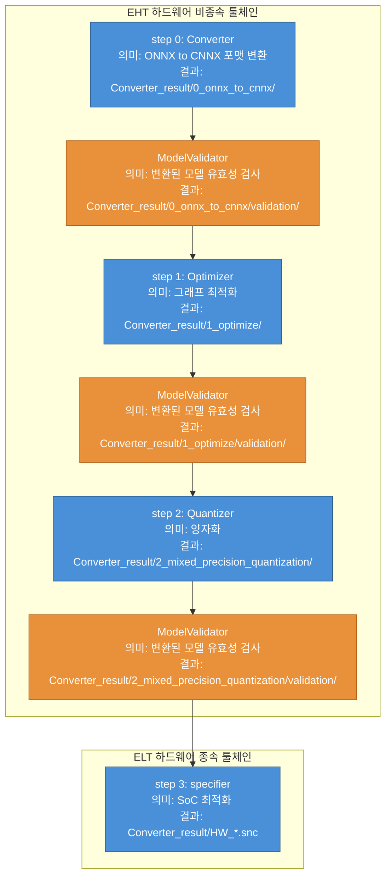

# Exynos AI Studio (EAIS) CLI 사용자 가이드

## 목차

- [용어 정의](#용어-정의)

1. [CLI 파이프라인](#1-cli-파이프라인)
2. [워크스페이스 구조](#2-워크스페이스-구조)
3. [단계별 CLI 사용법](#3-단계별-cli-사용법)
   - [Step 1: init](#step-1-init--워크스페이스-초기화)
   - [Step 2: generation](#step-2-generation--캘리브레이션-데이터-생성)
   - [Step 3: conversion](#step-3-conversion--모델-변환)
     - [ModelValidator](#modelvalidator--변환된-모델-유효성-검사)
     - [\<model_name\>.yaml 파라미터 가이드](#model_nameyaml-파라미터-가이드)
   - [Option: debug](#option-debug--conversion-모듈-산출물-정확도-비교-및-모델-시각화) → 상세 내용은 [eais_debug_guide.md](documentation/sdk-3.0/debug-guide)
   - [Step 4: compile](#step-4-compile--snc를-nnc로-컴파일)
   - [Step 5: profiling](#step-5-profiling--실기기-성능-측정)
   - [nnc-reader](#nnc-reader--nnc-파일-내용-출력)
4. [주의사항 및 트러블슈팅](#4-주의사항-및-트러블슈팅)
5. [Quick Start & 실전 예시: UDClassifier 모델 변환](#5-quick-start--실전-예시-udclassifier-모델-변환)

---

## 용어 정의

### EAIS (Exynos AI Studio)

EAIS는 AI 모델을 Exynos NPU에서 실행할 수 있도록 변환·최적화·검증하는 툴킷입니다. ONNX, TFLite 등의 모델을 입력받아 NPU에서 실행 가능한 `.nnc` 포맷으로 변환합니다.

### 워크스페이스 (Workspace)

워크스페이스 개념과 폴더 구조 개요는 [EAIS_WhatsNew_SDK3.0.md → 워크스페이스(workspace)란?](documentation/sdk-3.0/whats-new#워크스페이스workspace란)을 참고하세요. `eais init` 실행 후 생성되는 파일 상세 구조는 [§2 워크스페이스 구조](#2-워크스페이스-구조)에서 다룹니다.

### SNC (Samsung Neural network Container)

SNC는 자체 개발한 **중간 표현(IR, Intermediate Representation)** 포맷입니다.
IR이란 신경망을 기술하기 위한 형식으로, PyTorch에서 내보내는 ONNX나 TensorFlow에서 내보내는 TFLite가 모두 IR의 일종입니다.
EAIS 파이프라인은 ONNX, TFLite 등 다양한 외부 IR을 입력으로 받아, 내부에서 일관되게 처리할 수 있도록 자체 IR인 **SNC**로 변환합니다.

### CNNX

CNNX는 **EHT 툴체인에서 사용되는 IR**입니다.
ONNX 모델 파일(`.onnx`)과 양자화 정보가 담긴 encodings 파일(`.encodings`)의 쌍을 묶어 CNNX라고 부릅니다.

### EHT / ELT

Exynos AI Studio는 두 개의 툴체인으로 구성됩니다.

- **EHT (Exynos High-level Toolchain)**: 하드웨어 비종속 단계를 담당하는 상위 툴체인입니다. converter → optimizer → quantizer 모듈을 순차 실행해 IR 변환·그래프 최적화·양자화를 수행하고, 결과물로 quantized CNNX(`.onnx` + `.encodings`)를 생성합니다.
- **ELT (Exynos Low-level Toolchain)**: 하드웨어 종속 단계를 담당하는 하위 툴체인입니다. ELT에 속하는 모듈인 specifier가 EHT의 최종 산출물인 quantized CNNX를 입력으로 받아 타겟 SoC에 최적화된 **HW SNC** 파일을 생성합니다.

`eais conversion` CLI는 EHT → ELT 툴체인을 순차적으로 실행합니다.


---

## 1. CLI 파이프라인

각 CLI의 실행 순서를 나타낸 다이어그램입니다. 각 CLI에서 생성된 산출물의 경로는 워크스페이스를 기준으로 합니다.



최소 절차는 [§5 Quick Start & 실전 예시](#5-quick-start--실전-예시-udclassifier-모델-변환)에서 다룹니다.

---

## 2. 워크스페이스 구조

워크스페이스 준비 방법과 `eais init` 실행 후 생성되는 파일 구조를 설명합니다.

### 준비 방법
워크스페이스 폴더 안에 폴더명과 동일한 이름의 모델 파일을 배치합니다. `eais init` 실행 시 폴더명과 동일한 이름의 yaml 파일이 생성됩니다.
```
<workspace>/           
└── <model_name>.onnx   # 또는 .tflite
```

예시:
```
/home/user/eais-projects/
└── MyModel/
    └── MyModel.onnx
```


### init 실행 후 생성되는 구조

```
<workspace>/
├── <model_name>.onnx
├── <model_name>.yaml                     ← 기본 설정 파일 (핵심)
├── .input_conf.json                      ← 입력 모델 경로 정보
├── package-info.txt                      ← EAIS 버전 정보
└── Config/
    ├── DATA/
    │   └── dbgen_spec.yaml               ← 캘리브레이션 데이터셋 사양 (수동 편집 필요)
    ├── compiler_tuning_mode_config.yaml  ← compile 튜닝 모드 설정
    ├── conversion_expert.yaml            ← conversion 고급 파라미터
    ├── debug.yaml                        ← debug 설정
    ├── layer_device_config.yaml          ← layer별 실행 device 설정
    ├── post_processing_config.yaml       ← simulator 후처리 설정
    ├── pre_processing_config.yaml        ← simulator 전처리 설정
    ├── profiler_advanced_config.yaml     ← profiling 고급 설정
    └── remote_ssh_config.yaml            ← 원격 SSH 접속 설정
```

---

## 3. 단계별 CLI 사용법

각 CLI는 `--w <workspace_path>` 옵션으로 대상 워크스페이스를 지정할 수 있습니다.

> [!TIP]
> **`--w` 옵션 생략하기:** 모든 명령어는 `--w`의 기본값이 현재 작업 디렉토리(CWD)입니다.
> 워크스페이스 폴더 안에서 CLI 실행시, `--w`를 생략할 수 있습니다.
> ```bash
> cd /home/user/eais-projects/MyModel
> eais init        # eais init --w /home/user/eais-projects/MyModel 과 동일
> eais generation
> eais conversion
> eais debug
> ```

### Step 1: init — 워크스페이스 초기화

#### 명령어
```bash
eais init --w <workspace_path>
```

#### 예시
```bash
eais init --w /home/user/eais-projects/MyModel
```

#### 동작
- `<model_name>.yaml` 생성
- `Config/` 디렉토리 및 하위 설정 파일 생성
- `Config/DATA/dbgen_spec.yaml` 생성 (랜덤 데이터 기본값)

> [!WARNING]
> - 워크스페이스 준비 규칙(폴더명 = 모델 파일명)은 [§2 워크스페이스 구조](#2-워크스페이스-구조) 참고.
> - 이미 init된 워크스페이스에서 재실행하면 기존 yaml을 덮어씁니다.

---

### Step 2: generation — 캘리브레이션 데이터 생성

#### 명령어
```bash
eais generation --w <workspace_path>
```

#### 예시
```bash
eais generation --w /home/user/eais-projects/MyModel
```

#### 동작
- `Config/DATA/dbgen_spec.yaml`을 읽어 캘리브레이션 가능한 포맷의 npy 데이터를 생성합니다.
- 생성된 npy 파일은 conversion의 캘리브레이션 데이터로 사용됩니다.

#### 주요 출력물
```
Config/DATA/
├── database.txt                           ← 생성된 npy 파일 경로 목록
├── database.json                          ← 데이터베이스 메타 정보
└── input_data/
    ├── input_folder_mapping.json          ← 입력 이름-폴더 매핑
    └── <input_name>/                      ← 모델 입력 이름별 폴더
        ├── database_0000.npy              ← 샘플별 npy 파일
        ├── database_0001.npy
        └── ...
```

- **`<input_name>/`**: 모델의 각 입력 텐서 이름에 대응하는 폴더입니다. `dbgen_spec.yaml`의 최상위 키(예: `data`, `feat_128`)가 폴더 이름이 됩니다.
- **`input_folder_mapping.json`**: 모델 입력 이름과 해당 npy 폴더 간의 매핑 정보를 담고 있습니다. conversion 파이프라인이 이 파일을 참조해 각 입력에 맞는 캘리브레이션 데이터를 로드합니다.

#### dbgen_spec.yaml 작성 방법

`Config/DATA/dbgen_spec.yaml`은 **반드시 실제 모델의 입력 개수에 맞게 수동으로 편집**해야 합니다.
`eais init` 시 랜덤 데이터 생성이 기본값으로 설정되므로, 그대로 사용하면 변환 품질이 저하될 수 있습니다.

**작성 규칙**
- 최상위 키(예: `data`, `feat_128`)는 **모델의 입력 텐서 이름**으로 작성합니다. 이 이름이 `eais generation` 실행 시 생성되는 `input_data/` 하위 폴더 이름이 되며, conversion 파이프라인이 각 입력을 매핑할 때 사용합니다.
- `shape`과 `order`는 파일 확장자(`ext`)에 상관없이 항상 정의합니다.

**필드 설명**

| 필드 | 설명 | 허용값 |
|---|---|---|
| `random` | `True`이면 실제 데이터셋 없이 랜덤 텐서를 생성. dtype이 float이면 `[0.0, 1.0)` 균등분포, int이면 해당 타입의 전체 범위에서 균등 샘플링 | `True` / `False` |
| `path` | 데이터셋 폴더. 워크스페이스 기준 상대경로 권장 (자세한 규칙은 아래 [path 경로 주의사항](#path-경로-주의사항) 참고) | 상대경로 / 절대경로 |
| `ext` | 파일 확장자 | `jpg`, `jpeg`, `png`, `bmp`, `raw`, `bin` |
| `shape` | 모델 입력 텐서의 shape. `ext` 종류에 상관없이 항상 정의 | 예: `(1, 3, 384, 384)` |
| `order` | 입력 데이터의 차원 순서. `nchw`: (batch, channel, height, width) — PyTorch 기본. `nhwc`: (batch, height, width, channel) — TensorFlow/OpenCV 기본 | `nchw`, `nhwc`, `chw`, `hwc` |
| `dtype` | 데이터 타입 | `float32`, `float16`, `float64`, `uint8`, `int8`, `uint16`, `int16`, `int32`, `int64`, `bool` |
| `mean` | 전처리 평균값. `output = (raw - mean) * scale`. 스칼라 또는 채널 수만큼의 리스트. 기본값 `0` (평균 감산 없음) | 예: `[0]`, `[0.485, 0.456, 0.406]` |
| `scale` | 전처리 스케일. `scale > 1`이면 내부적으로 `1/scale`로 역수 변환됨. 예: `scale: 255` → 픽셀 값을 255로 나눠 `[0, 1]` 정규화. 기본값 `1` | 예: `[1]`, `[255]` |

> [!NOTE]
> 준비하신 데이터셋이 추가 전처리가 필요 없다면 `mean: [0]`, `scale: [1]` 기본값을 그대로 두세요. `output = (raw - 0) * 1 = raw`가 되어 raw 파일이 그대로 캘리브레이션 데이터로 사용됩니다.

##### 실제 데이터셋 사용 시 (권장)
```yaml
data:
  random: False
  path: ./dataset
  ext: raw
  shape: (1, 3, 384, 384)
  order: nchw
  dtype: float32
  mean: [0]
  scale: [1]
```

##### 입력이 여러 개인 경우
모델 입력이 여러 개일 때는 각 모델 입력 이름마다 정보를 명시합니다.
```yaml
data:
  random: False
  path: ./dataset/data
  shape: (1, 3, 512, 512)
  dtype: float32
  order: nchw
  ext: raw
feat_128:
  random: False
  path: ./dataset/feat_128
  shape: (1, 56, 128, 128)
  dtype: float32
  order: nchw
  ext: raw
feat_64:
  random: False
  path: ./dataset/feat_64
  shape: (1, 112, 64, 64)
  dtype: float32
  order: nchw
  ext: raw
```

##### 랜덤 데이터 사용 시 (빠른 테스트용)
```yaml
data:
  random: True
  shape: (1, 3, 384, 384)
  order: nchw
  dtype: float32
  mean: [0]
  scale: [1]
```

> [!NOTE]
> `random: True`인 경우에도 `shape`, `order`, `dtype`은 반드시 실제 모델 입력에 맞게 지정해야 합니다. EAIS는 이 값을 기준으로 랜덤 텐서를 생성합니다.

#### path 경로 주의사항

> [!NOTE]
> **path 경로 주의:** 상대경로는 워크스페이스 폴더(`Config/DATA/dbgen_spec.yaml`이 위치한 폴더)를 기준으로 해석됩니다.
> 예를 들어 워크스페이스가 `~/MyModel/` 이고 데이터셋이 `~/MyModel/dataset/` 에 있다면 `path: ./dataset` 으로 지정합니다.
> 워크스페이스 밖의 데이터셋을 참조하려면 절대경로 (예: `/data/calibration/MyModel/`) 를 사용합니다.

| 입력 예시 | 해석 방식 | 권장 여부 |
|---|---|---|
| `path: ./dataset` | `<workspace>/dataset` | **권장** (워크스페이스 안에서 실행 시) |
| `path: /home/user/eais-projects/MyModel/dataset` | 절대경로 | 가능 |

---

### Step 3: conversion — 모델 변환

#### 모듈 설명

`eais conversion`은 아래 모듈들을 순서대로 실행합니다.

| 모듈 | 툴체인 | 역할 |
|---|---|---|
| **Converter** | EHT | 외부 IR(ONNX / TFLite)을 EHT IR인 CNNX(ONNX + Encodings) 포맷으로 변환합니다. |
| **Optimizer** | EHT | CNNX 그래프를 분석해 불필요한 연산을 제거하거나 병합하는 등 하드웨어 비종속 그래프 최적화를 수행합니다. |
| **Quantizer** | EHT | 캘리브레이션 데이터를 사용해 mixed-precision 양자화를 적용합니다.|
| **ModelValidator** | EHT | Converter, Optimizer, Quantizer 각 단계 직후 자동으로 호출되어 변환된 모델의 유효성을 검사합니다. |
| **Specifier** | ELT | 양자화된 CNNX를 입력으로 받아 타겟 SoC에 최적화된 HW SNC를 생성합니다. |

#### 내부 파이프라인

`eais conversion`은 EHT → ELT 순서로 4단계 모듈을 실행합니다.



#### 명령어
```bash
eais conversion [--w WORKSPACE_PATH] [--f YAML_PATH]
                [--eht | --elt]
                [--<key> <value> ...]
```

#### 옵션

| 옵션 | 기본값 | 설명 |
|---|---|---|
| `--w WORKSPACE_PATH` | 현재 작업 디렉토리 | 워크스페이스 경로. 모델 파일과 동일한 이름의 폴더여야 하며, `eais init`으로 초기화되어 있어야 합니다. |
| `--f FILE` | `<workspace>/<model_name>.yaml` | 변환 파라미터를 정의하는 YAML 설정 파일 경로. 기본값은 `eais init` 시 생성된 `<model_name>.yaml`. 대체 설정 파일을 지정할 때 사용합니다. |
| `--eht` | 미설정 | EHT 단계만 실행: converter → ModelValidator → optimizer → ModelValidator → quantizer → ModelValidator. 하드웨어 비종속 변환을 수행하며 quantized CNNX (ONNX + encodings) 생성. 하드웨어 종속 단계를 의도적으로 건너뛸 때만 사용. **대부분의 경우 `--eht`, `--elt` 모두 생략 권장.** |
| `--elt` | 미설정 | specifier 단계만 실행. 이미 완료된 EHT 결과(quantized CNNX)를 기반으로 device-specific SNC 생성. 워크스페이스에 유효한 EHT 결과가 있을 때만 사용. **대부분의 경우 `--eht`, `--elt` 모두 생략 권장.** |
| `--<key> <value>` | 없음 | YAML 설정 파일의 파라미터를 덮어쓰는 추가 옵션. 가장 높은 우선순위를 가집니다. 예: `--precision A8W8 --device Gen-8` |

#### 예시

```bash
# 기본 실행 (EHT + ELT 전체 파이프라인, 대부분의 경우 권장)
eais conversion --w /home/user/eais-projects/MyModel

# 대체 YAML 설정 파일 지정
eais conversion --w /home/user/eais-projects/MyModel \
  --f /home/user/eais-projects/MyModel/MyModel_A16W8.yaml

# CLI에서 파라미터 오버라이드 (YAML 수정 없이 실행)
eais conversion --w /home/user/eais-projects/MyModel \
  --precision A16W8 --calibration_method percentile

# EHT 단계만 실행 (하드웨어 비종속 변환, quantized CNNX 생성)
eais conversion --w /home/user/eais-projects/MyModel --eht

# ELT 단계만 실행 (EHT 결과 재활용, 다른 타겟 SoC로 재변환)
eais conversion --w /home/user/eais-projects/MyModel --elt --device Gen-8

# CLI에서 device 파라미터만 오버라이드 (YAML 수정 없이 타겟 변경)
eais conversion --w /home/user/eais-projects/MyModel --device Gen-9
```

#### 주요 출력물
```
<workspace>/
├── Converter_result/
│   ├── 0_onnx_to_cnnx/output.onnx
│   ├── 1_optimize/output.onnx
│   ├── 2_mixed_precision_quantization/output.onnx
│   ├── HW_<model_name>_<version>.snc     ← NPU 실행용 최종 변환 모델
│   └── NPU_<model_name>/testvector/       ← compile용 테스트 벡터
└── Debug_result/
    └── pipeline_artifacts.json           ← eais debug 명령에 필요
```


> [!WARNING]
> - conversion 전에 반드시 `eais generation`으로 npy 캘리브레이션 데이터를 먼저 생성해야 합니다.
> - `calibration_data_path`가 가리키는 폴더에 npy 파일이 없으면 h5 파일이 존재하는지 확인 후 해당 파일도 없다면 캘리브레이션이 실패합니다.
> - conversion 완료 후 `Debug_result/pipeline_artifacts.json`이 자동 생성됩니다. `eais debug --mode accuracy` / `--mode all` 실행 시 이 파일이 필요합니다.

### ModelValidator — 변환된 모델 유효성 검사

Converter 완료 직후, Optimizer 완료 직후, Quantizer 완료 직후, 총 세 번 수행됩니다. 검사 결과는 각 단계 결과 디렉토리 하위 `validation/`에 저장됩니다.

```
Converter_result/
├── 0_onnx_to_cnnx/
│   └── validation/
│       └── model_validation_results/
│           ├── output.onnx              ← 검사 대상 모델 (수정본, 변경 없을 경우 원본과 동일)
│           ├── output.encodings         ← 검사 대상 encodings (CNNX 단계에만 존재)
│           ├── report.html              ← 검사 결과 HTML 리포트
│           └── validation_report.json   ← 검사 결과 JSON (validator별 PASSED/FAILED 및 상세)
├── 1_optimize/
│   └── validation/
│       └── model_validation_results/
│           └── ...
└── 2_mixed_precision_quantization/
    └── validation/
        └── model_validation_results/
            └── ...
```

#### validation_report.json 구조

`validation_report.json`은 검사 항목별 결과를 담고 있습니다.

- **`metadata.ir_type`**: 검사 대상 IR 타입 (`onnx` / `cnnx`)
- **`results`**: validator별 결과. 모두 통과한 경우 빈 객체 `{}`
  - **`status`**: `PASSED` / `FAILED`
  - **`fail_list`**: 실패한 항목 목록. 각 항목은 노드명, 오류 코드, 메시지, 원인을 포함

**모두 통과한 경우** (`0_onnx_to_cnnx` 단계, `ir_type: onnx`):

```json
{
  "metadata": {
    "ir_type": "onnx"
  },
  "results": {}
}
```

`report.html`에서는 각 validator의 상태를 Summary 표와 상세 패널로 확인할 수 있습니다.


**FAILED가 있는 경우** (`2_mixed_precision_quantization` 단계, `ir_type: cnnx`):

```json
{
  "metadata": {
    "ir_type": "cnnx"
  },
  "results": {
    "weight_granularity": {
      "validator_name": "weight_granularity",
      "status": "FAILED",
      "fail_list": [
        {
          "name": "/stage2/0/1/2_1/Resize/dwdeconv/weight_2",
          "code": "InvalidWeightSymmetry",
          "message": "Weight symmetry configuration is invalid",
          "component": "KERNEL",
          "info": {
            "node_name": "/stage2/0/1/2_1/Resize/DWDeconv_5",
            "op_type": "ConvTranspose",
            "enc_type": "PER_TENSOR",
            "is_sym": true,
            "expected_sym": false,
            "reason": "PER_TENSOR must be asymmetric"
          }
        }
      ],
      "info": null,
      "corrections": []
    }
  }
}
```

`report.html`의 Summary 표에서 FAILED 항목을 한눈에 확인하고, 상세 패널에서 실패한 노드별 원인을 확인할 수 있습니다.


Converter·Optimizer 이후에는 ONNX 모델 검사 항목(4가지)이 수행됩니다.

| Validator | 검사 내용 |
|---|---|
| `DynamicInputValidator` | 그래프 입력에 `"batch"`, `"seq_len"` 등 비정수 동적 차원이 있는지 검사 |
| `RuntimeCompatibilityValidator` | ONNX Runtime으로 더미 입력을 넣어 모델이 정상 실행되는지 확인 |
| `OpsetVersionValidator` | ONNX opset 버전 검사: {13–21}은 통과, {1–12}는 13으로 자동 변환 가능, 그 외는 실패 |
| `ContainsEinsumValidator` | downstream 툴체인이 지원하지 않는 `Einsum` 연산자가 있는지 검사 |

Quantizer 이후에는 위 항목에 더해 양자화 encodings 관련 항목(CNNX 검사)이 추가로 수행됩니다.

| Validator | 검사 내용 |
|---|---|
| `AttributeConstraintValidator` | 노드 속성값 하드웨어 제약 검사 (음수 `axis` 등 비허용 값 검출) |
| `ConstantConstraintValidator` | 상수·초기화 텐서에 `+/-Inf` 값이 있는지 검사 |
| `UnexpectedActivationQParamValidator` | Shape, Gather, Cast 등 qparam이 불필요한 연산자 출력에 qparam이 붙어 있는지 검사 |
| `UnexpectedParamQParamValidator` | bias, 양자화 금지 연산자의 파라미터 등 qparam이 붙어서는 안 되는 위치에 qparam이 있는지 검사 |
| `QParamIsSymFormatValidator` | `is_sym` 필드가 AIMET 표준 형식(`"True"`/`"False"`)인지 검사 |
| `QParamOffsetRangeValidator` | 대칭/비대칭 여부에 따라 qparam offset이 유효 범위 내인지 검사 |
| `QParamBitwidthValidator` | activation bitwidth ∈ {8, 16}, weight bitwidth ∈ {4, 8} 인지 검사 |
| `QParamFormatValidator` | `quantizer_args`가 존재하고 null 값 없이 올바른 형식인지 검사 |
| `TrivialQParamValidator` | `scale=1.0`, `offset=-(2^bw-1)` 로 실질적인 양자화가 없는 identity qparam 검출 |
| `MissingActivationQParamValidator` | float activation·graph input에 qparam이 누락되어 있는지 검사 |
| `MissingParamQParamValidator` | Conv, Gemm, MatMul 등의 weight에 qparam이 누락되어 있는지 검사 |
| `PassthroughQParamValidator` | Reshape, Transpose, Slice 등 passthrough 연산자의 입출력 qparam이 동일한지 검사 |
| `OutputQParamConsistencyValidator` | Split 등 동일 출력 qparam이 요구되는 연산자의 모든 출력 qparam이 일치하는지 검사 |
| `ConcatQParamConsistencyValidator` | Concat 노드의 입출력 qparam이 일치하는지 검사 |
| `ConstantActivationQParamValidator` | Add, Mul의 상수 입력 encoding이 `param_encodings`가 아닌 `activation_encodings`에 기록되어 있는지 검사 |
| `WeightGranularityValidator` | weight qparam granularity 검사: PER_TENSOR는 asymmetric, PER_CHANNEL은 symmetric이어야 하며 scale 수가 채널 축 크기와 일치해야 함 |
| `ActivationDtypeValidator` | 모든 activation 텐서의 dtype이 `float` 또는 `float16`인지 검사 |
| `AimetCompatibilityValidator` | AIMET `QuantizationSimModel`에 로드하여 encoding 이름이 `qc_quantize_op_dict`에 존재하는지 검사 |

### \<model_name\>.yaml 파라미터 가이드

`eais init` 실행 후 `<workspace>/<model_name>.yaml`이 생성됩니다.
이 파일이 모든 CLI의 기본 파라미터 소스입니다.

#### general 섹션

`eais init` 실행 시 생성되는 기본 설정 파일로, EAIS 파이프라인 전체에서 참조됩니다.

| Key | Default | Description |
|---|---|---|
| `device` | `Gen-9` | 모델이 실행될 SoC 타겟. 배포 대상 하드웨어에 맞게 설정합니다. |

| Value | Description |
|---|---|
| `Gen-9` | Ulysses (S5E9975) |
| `Gen-8` | Thetis (S5E9965) |
| `Gen-7` | Solomon (S5E9955), Terra (S5E8865), Vesper (S5E8875) |
| `Gen-6` | Root (S5E9945) |
| `Gen-5` | Quadra (S5E9945), Santa (S5E8855), Rose (S5E8845), Kitt2 (S5AV920) |
| `Gen-4` | Pamir (S5E9925) |
| `Gen-3` | Olympus (S5E9840), Quartz (S5E8835) |
| `Gen-2` | 2020AP (S5E9830) |

> [!WARNING]
> `device` 설정이 실제 타겟 하드웨어와 다르면 compile/profiling 결과가 무효합니다.

#### database_gen 섹션

| Key | Default | Description |
|---|---|---|
| `database_spec` | `Config/DATA/dbgen_spec.yaml` | `eais generation` 시 참조할 스펙 파일 경로. 워크스페이스 루트 기준 상대경로. |

#### converter 섹션

| Key | Default | Description |
|---|---|---|
| `use_cuda` | `false` | ONNX/CNNX 변환 및 양자화 시 CUDA(GPU) 사용 여부. GPU 가속 시 캘리브레이션 속도가 크게 향상됩니다. |
| `precision` | `A8W8` | 양자화 정밀도 프로파일. 이미 양자화된 모델은 `skip_quantization: true` 사용. |
| `skip_quantization` | `false` | 양자화 단계 건너뜀. `true`로 설정 시 입력이 이미 양자화된 것으로 간주하고 specifier로 바로 진행. |
| `calibration_mode` | `default` | 캘리브레이션 모드. |
| `calibration_method` | `minmax` | PTQ 양자화 범위(scale/offset) 추정 알고리즘. |
| `calibration_data_path` | `Config/DATA` | 캘리브레이션 데이터셋 폴더 경로. 모델 입력별 서브 폴더와 `dbgen_spec.yaml`을 포함합니다. |
| `input_dtype` | `float32` | 양자화 모델의 입력 텐서 dtype 강제 지정. 기본적으로 float32로 가정하며, 다른 dtype이 필요한 경우 설정합니다. |
| `output_dtype` | `float32` | `input_dtype`과 동일. |
| `advanced_quantization_algorithm` | `null` | 표준 양자화 위에 적용하는 선택적 가중치 튜닝 알고리즘. |
| `graph_opt` | `common` | 특정 모델 패밀리에 맞는 그래프 최적화 프로파일. |
| `expert_yaml` | `Config/conversion_expert.yaml` | 이 파일의 값을 확장/오버라이드하는 고급 변환 설정 파일 경로. |

##### `use_cuda`

| Value | Description |
|---|---|
| `true` | GPU에서 캘리브레이션 실행 (빠름, CUDA 지원 장치 필요) |
| `false` | CPU에서 캘리브레이션 실행 |

##### `precision`

| Value | Description |
|---|---|
| `FP16` | 16-bit 부동소수점, 정수 양자화 없음 |
| `A16W8` | 16-bit activation, 8-bit weight |
| `A16W4` | 16-bit activation, 4-bit weight |
| `A8W8` | 8-bit activation, 8-bit weight (가장 일반적인 정수 프로파일) |
| `A8W4` | 8-bit activation, 4-bit weight |
| `MXINT8` | Microscaling INT8 |

##### `calibration_mode`

| Value | Description |
|---|---|
| `default` | `calibration_method`에 지정된 방법을 캘리브레이션 데이터 전체에 적용 |
| `auto` | weight/activation 유형별로 최적의 캘리브레이션 방법을 자동 탐색 |

##### `calibration_method`

| Value | Description |
|---|---|
| `minmax` | 텐서 min/max로 직접 scale 산출. 가장 빠름 |
| `percentile` | 백분위수 기반 아웃라이어 클리핑. heavy-tailed 분포에 유용 |
| `histogram_enhanced` | AIMET tf-enhanced, 히스토그램 기반 KL divergence 최소화. 가장 정확하나 느림 |

##### `input_dtype` / `output_dtype`

| Value | Description |
|---|---|
| `float32` | 32-bit float (기본값) |
| `float16` | 16-bit float |
| `uint8` | unsigned 8-bit |
| `int8` | signed 8-bit |
| `uint16` | unsigned 16-bit |
| `int16` | signed 16-bit |
| `none` | 모델 원본 dtype 유지 |

##### `advanced_quantization_algorithm`

| Value | Description |
|---|---|
| `smoothquant` | activation-weight 공동 스케일링으로 양자화 오차 감소 |
| `adaround` | 저비트 양자화를 위한 학습 기반 per-weight 반올림 결정 |
| `null` | 고급 알고리즘 미적용 |

##### `graph_opt`

| Value | Description |
|---|---|
| `gaussi_xs_unet` | GaussI XS U-Net |
| `gaussi_xs_te` | GaussI XS text encoder |
| `gaussi_xs_ie` | GaussI XS image encoder |
| `gaussi_xs_vae_decoder` | GaussI XS VAE decoder |
| `gaussi_xs_ip` | GaussI XS image prompt |
| `s26_gausslprefill` | S26 GaussL prefill |
| `animated_diff` | AnimatedDiff |
| `semantic_search` | Semantic search 모델 |
| `common` | 범용 최적화 |
| `none` | 그래프 최적화 없음 |

#### compiler 섹션

| Key | Default | Description |
|---|---|---|
| `mode` | `default` | 컴파일러 프리셋. 내장 파라미터 번들을 선택합니다. |
| `debug_str` | `null` | 컴파일러로 전달되는 선택적 디버그 플래그 문자열. 특정 빌드 재현 시에만 설정합니다. |
| `compiler_advanced_config` | `Config/compiler_tuning_mode_config.yaml` | `mode=tuning_mode` 시 사용할 고급 컴파일러 설정 파일 경로. |

##### `mode`

| Value | Description |
|---|---|
| `default` | 표준 단일 코어 빌드 |
| `multicore` | 멀티코어 레이아웃/스케줄링 활성화 |
| `tuning_mode` | `compiler_advanced_config` 파일의 파라미터 사용 (고급 사용자용) |
| `gen-ai` | Generative AI 최적화 프리셋 |
| `gaussl` | GaussL 프리셋 |
| `gaussi` | GaussI 프리셋 |

#### profiler 섹션

| Key | Default | Description |
|---|---|---|
| `device_id` | `NOT_USE` | EAIS docker가 실행 중인 서버/PC에 연결된 타겟 기기의 숫자 ID. |
| `ssh_bool` | `SSH_FALSE` | Profiler가 기기에 접근하는 방법. |
| `profiler_advance_config` | `Config/profiler_advanced_config.yaml` | 고급 profiler 설정 파일 경로. |

##### `device_id`

| Value | Description |
|---|---|
| `<number>` | `adb devices` 또는 기기 관리자에서 확인된 기기 ID |
| `NOT_USE` | 연결된 기기 없이 실행 (기기 선택 생략) |

##### `ssh_bool`

| Value | Description |
|---|---|
| `SSH_TRUE` | SSH를 통해 원격 기기에 연결 |
| `SSH_FALSE` | 직접 연결된 기기 사용 (USB / 로컬) |

---

### Option: debug — conversion 모듈 산출물 정확도 비교 및 모델 시각화

명령어, 옵션 및 파라미터, 상세 사용법은 [eais_debug_guide.md](documentation/sdk-3.0/debug-guide)를 참고하세요.

---

### Step 4: compile — SNC를 NNC로 컴파일
```bash
eais compile --w <workspace_path>
```
- `Converter_result/HW_*.snc`를 NPU 실행 가능한 `.nnc` 파일로 컴파일합니다.
- 출력: `Compiler_result/<model_name>.nnc`

| `compiler.mode` 값 | 설명 |
|---|---|
| `default` | 기본 설정 |
| `multicore` | NPU 멀티코어 활용 |
| `tuning_mode` | `compiler_tuning_mode_config.yaml`로 세부 튜닝 |
| `gen-ai` | Generative AI 모델 최적화 |

### Step 5: profiling — 실기기 성능 측정
```bash
eais profiling --w <workspace_path>
```
- 실제 Exynos 기기에서 `.nnc` 모델의 추론 시간과 메모리 사용량 등을 측정합니다.
- 출력: `Profiler_result/`
- 기기 연결이 필요하며, `profiler.device_id`, `profiler.ssh_bool` 등을 사전에 설정해야 합니다.

### nnc-reader — NNC 파일 내용 출력
```bash
eais nnc-reader <path/to/model.nnc>
```
- 컴파일된 `.nnc` 파일의 레이어 구조 및 메타 정보를 터미널에 출력합니다.

---

## 4. 주의사항 및 트러블슈팅


### 자주 발생하는 오류

#### 1. `EAIS error: files with model name '<name>' does not exist in workspace.`

워크스페이스 **폴더명**과 `.onnx` / `.tflite` **파일명**이 일치하지 않을 때 발생합니다.

**예시 오류 메시지**
```
Error code: 102
Error msg: workspace error
Details:
files with model name 'mismatch' does not exist in workspace.
```

**원인:** EAIS는 워크스페이스 폴더명을 기준으로 모델 파일을 찾습니다. 폴더명이 `mismatch`인데 내부에 `differentname.onnx`만 있으면 `mismatch.onnx`를 찾지 못해 실패합니다.

```
mismatch/
└── differentname.onnx     # ❌ 폴더명과 다름
```

**해결:** 모델 파일명 또는 폴더명을 맞춥니다.
```
01-5_model/
└── 01-5_model.onnx        # ✅ 폴더명 = 파일명
```

#### 2. `ValueError: cannot reshape array of size <N> into shape (...)`

`eais generation` 실행 시 `dbgen_spec.yaml`에 지정한 `shape`, `dtype`, `order`가 실제 raw 파일 크기와 맞지 않아 numpy가 해당 형태로 reshape하지 못할 때 발생합니다.

**예시 오류 메시지**
```
ValueError: cannot reshape array of size 786432 into shape (1,1,3,999,999)
...
RuntimeError: Pipeline failed: Pipeline failed at step 0: step_0_dbgen_database_gen
```

**원인:** `.raw` 파일의 실제 바이트 수 = `dtype 크기 × shape 원소 개수`가 성립해야 합니다.
예: `shape: (1, 3, 384, 384)`, `dtype: float32` → 파일 크기는 `4 × 1 × 3 × 384 × 384 = 1,769,472 bytes`

**해결:** raw 파일의 실제 크기에 맞게 `shape`, `dtype`을 수정합니다. 이미지 처리 모델의 경우 대부분 모델 입력 텐서의 shape/dtype과 일치해야 합니다.

#### 3. `IndexError: list index out of range` (`--elt` 단독 실행 시)

EHT 결과 없이 `--elt`만 단독으로 실행할 때 발생합니다. `--elt`는 이미 완료된 EHT 결과(quantized CNNX)가 있을 때 이를 재활용하는 옵션입니다.

**예시 오류 메시지**
```
File ".../eais/models/converter.py", line 68, in refactor_input_model
    if os.path.exists(os.path.join(output_dir, sorted_eht_result[-1], ...)):
IndexError: list index out of range
```

**원인:** 워크스페이스의 `Converter_result/`에 유효한 EHT 결과 (`0_onnx_to_cnnx/`, `1_optimize/`, `2_mixed_precision_quantization/`)가 없음

**해결:**
- 처음 변환하는 경우: 옵션 없이 `eais conversion --w <workspace>`로 전체 파이프라인 실행
- 다른 SoC로 재변환하는 경우에만: 먼저 `--eht`로 EHT 단계 완료 후 `--elt` 실행
  ```bash
  eais conversion --w <workspace> --eht
  eais conversion --w <workspace> --elt --device <다른_SoC>
  ```

#### 4. `Compile failed: Pipeline failed at step 0: step_0_graphgen_model_compile`

`eais compile`이 필요로 하는 `Converter_result/HW_*.snc` 파일을 찾지 못할 때 발생합니다. `eais conversion`을 실행하지 않았거나 중간에 실패한 경우가 대부분입니다.

**해결:** `eais conversion`을 정상 완료한 뒤 `eais compile`을 실행합니다.
```bash
eais conversion --w <workspace_path>
eais compile --w <workspace_path>
```

---

## 5. Quick Start & 실전 예시: UDClassifier 모델 변환

`01-1_Preview_UDClassifier` 워크스페이스를 기준으로 ONNX 모델을 NPU 실행 가능한 `.nnc`로 변환하는 최소 절차를 안내합니다. 각 단계의 상세 옵션은 [§3 단계별 CLI 사용법](#3-단계별-cli-사용법)을 참고하세요.

### 환경
- 모델: `01-1_Preview_UDClassifier.onnx`
- 입력 shape: `(1, 3, 384, 384)`, dtype: `float32`
- 데이터셋: `dataset/` 폴더 내 `.raw` 파일 (float32, 384×384×3)
- 컨테이너: `example_container` (호스트의 워크스페이스 폴더가 컨테이너에 마운트되어 있다고 가정합니다)

### Step 0: Docker 컨테이너 진입
```bash
docker exec -it example_container /bin/bash
```

### Step 1: 워크스페이스 초기화 — `<model_name>.yaml`, `Config/` 생성
```bash
eais init --w /home/user/eais-projects/01-1_Preview_UDClassifier
```

### Step 2: `dbgen_spec.yaml` 작성
```bash
# 컨테이너 내부에서 직접 파일 편집
vi /home/user/eais-projects/01-1_Preview_UDClassifier/Config/DATA/dbgen_spec.yaml
```

```yaml
data:
  random: False
  path: /home/user/eais-projects/01-1_Preview_UDClassifier/dataset
  ext: raw
  shape: (1, 3, 384, 384)
  order: nchw
  dtype: float32
  mean: [0]
  scale: [1]
```

### Step 3: 캘리브레이션용 `.npy` 데이터 생성
```bash
eais generation --w /home/user/eais-projects/01-1_Preview_UDClassifier
```

### Step 4: 모델 변환 (EHT + ELT 전체 파이프라인)
```bash
eais conversion --w /home/user/eais-projects/01-1_Preview_UDClassifier
```

### Step 5: (선택) 각 단계 정확도 검증
```bash
eais debug --w /home/user/eais-projects/01-1_Preview_UDClassifier
```

### Step 6: (선택) SNC → NNC 컴파일
```bash
eais compile --w /home/user/eais-projects/01-1_Preview_UDClassifier
```

### 결과물 확인
```
01-1_Preview_UDClassifier/
├── Converter_result/
│   └── HW_updated_model_new_snc_<version>.snc   ← Step 4 산출물 (NPU 실행용 변환 모델)
├── Debug_result/
│   └── accuracy_validation_results/
│       └── accuracy_comparison.xlsx              ← Step 5 산출물 (단계별 SNR/PSNR 리포트)
└── Compiler_result/
    └── 01-1_Preview_UDClassifier.nnc             ← Step 6 산출물 (NPU 실행 파일)
```
